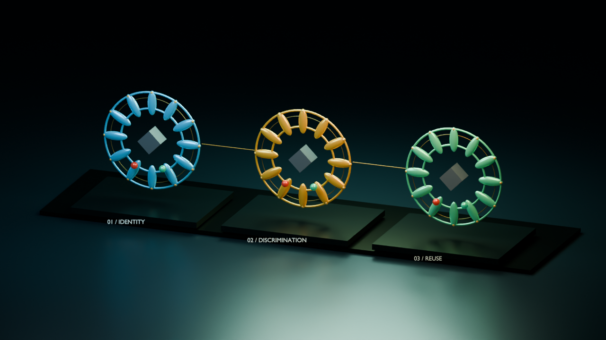
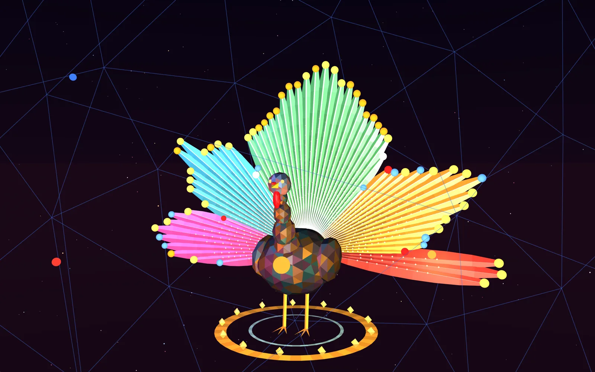

# Gobbler / The Evidence Loom

Twelve domain feathers, a pinned knowledge Atlas, and a local agent workflow.
Gobbler explores how a failure can become a tested technique that another
consumer can use. X3D carries the organism, relationships and explanatory
instruments; explicit records carry the evidence.

This extension reviews GitHub baseline
`11a561623b7539f1f9bf20f8ef7bc5b9706c10d2` and adds a three-experiment
**Intervention Lab**, repairs the existing scenes/frontend, and hardens the
evidence kernel and Flyte execution boundaries.



*Actual X3D import into Blender 5.2.4. Three gates and three rings pass measured
placement checks. Lighting, materials and readable typography are authored
studio presentation; see [receipt](receipts/review-blender.json). This image is
separate from native browser acceptance.*

## Where next: the frontier board, and two new Gobblers

[frontier/](frontier/README.md) is the Assayer's map of where the Loom could go: 64 frontiers put through the
Atlas's thirteen theses with no model call, ranked five ways, each rank with the range it moves over when the
opinions behind it are wrong. [mascot/](mascot/README.md) holds two drafts of the next Gobbler. Gobbler 5, the
Loomwright, wears that board as its tail fan; Gobbler 6, the Demiurge, has a woven body and a fan bred by a small
evolutionary search, whose first run gamed its own score and is kept as a record.



## Open locally

```bash
python3 serve.py
# http://localhost:8831/                 project front door
# http://localhost:8831/evidence-lab/    three experiments
# http://localhost:8831/gobbler-flyte/   full twelve-feather observatory
```

Windows: `py -3 serve.py` works with the same loopback URL. The viewer uses
bundled X_ITE 16.7.0, fonts and local scene/data assets. No package installation,
API key or internet is required for ordinary viewing. Use localhost or HTTPS
for Web Crypto. The observatory keeps the original soundtrack opt-in.

Other entry points: [field guide](evidence-lab/guide.html),
[original cinematic](gobbler-flyte/cinematic.html),
[single-file observatory](Gobbler-Evidence-Loom.html),
[historical Atlas reading edition](X3D-Flywheel-Atlas.html).

## Three experiments that expose the flywheel's rules

| Instrument | Change one condition | What becomes visible |
| --- | --- | --- |
| **Identity** | Append one newline, change geometry, or issue a matching digest yourself | Identical-looking geometry can have different byte identity. Self-issued matching hashes establish consistency, not independent review. |
| **Discrimination** | Replace the executed targeted checker with “always accept”; remove the failing controls | A pass rate on valid examples cannot establish that a guard detects a defect. Both positive and negative controls matter. |
| **Reuse** | Retry one consumption, add a different input/target, reuse the origin, or break input binding | A new row ID is not a new consumption. Count distinct qualified guard/target/input tuples. Qualification uses the Controls settings. |

Five authored shader fixtures are actually checked by the Python guard during
the deterministic Lab build. The browser verifies the saved fixture/catalog
bytes and executes hash comparisons, control-set qualification and retry
counting. The transfer ledger is explicitly synthetic protocol data: it does
not assert adoption by a live repository. The narrow shader guard does not
fetch, compile, link or render shaders.

The Lab starts static. Motion is an optional illustration, not a workload
meter. Gate colors encode local control outcomes; gray means unexamined.
Observation JSON and current X3D exports retain the catalog/tool identities and
scope. Viewpoint and field types are checked before readiness is advertised.

## What this review repaired

| Layer | Implemented response |
| --- | --- |
| Evidence kernel | Strict graph/count/pin/ref shapes; nonempty valid histories; incident-bound candidates; duplicate triples and malformed ledger witnesses rejected even after consistent rehashing. |
| Flyte | Offline/simulation mode isolation; explicit source provenance; independent evidence facets instead of path-based `Confirmed`; finite/full-precision budgets and usage dedup; exact decision/allowance parsing; atomic memory replacement and connection cleanup. |
| Frontend | Explicit ready/error/disposed states, bounded loading, stale-response protection, callback/RAF/media cleanup, reduced-motion changes, keyboard tabs and report-derived guard prose. |
| X3D geometry | Stable half-turn/vertical cameras, actual viewpoint aim, tether endpoints, planar vane triangles, aligned wheel discs, explicit shader URL encoding and defined smoothstep falloffs. |
| Export | Required template anchors fail loudly when the standalone builder no longer matches its source; actual rewritten JavaScript receives a syntax check. |
| Validation | Pinned full public X3D schemas/semantic instrument, defective controls, source-bound aggregate, runtime byte inventory, actual Accrete admission and an independently scoped Blender import. |

[Implementation review](docs/IMPLEMENTATION-REVIEW.md) maps baseline findings to
fixed behavior and remaining work. Detailed contracts:
[kernel](docs/KERNEL-REVIEW.md), [Flyte](docs/FLYTE-REVIEW.md),
[frontend](docs/FRONTEND-REVIEW.md), [scene](docs/SCENE-REVIEW.md),
[runtime](docs/RUNTIME-REVIEW.md).

## Rebuild and verify

Portable source/artifact checks use Python 3.12+ and Node (tested here with
Python 3.12 and Node 24):

```bash
python3 evidence-lab/build_lab.py
python3 gobbler-flyte/build_observatory.py
python3 gobbler-flyte/build_standalone.py --output Gobbler-Evidence-Loom.html
python3 verify.py
node --test tools/observatory-controls.test.mjs tools/intervention-tests.mjs tools/intervention-ui.test.mjs
```

For the complete release checks, use an isolated environment:

```bash
python3 -m venv .venv
# activate .venv, then:
python -m pip install -r tools/requirements-validation.txt -r flyte/requirements.txt
# actual admission controls also require a compatible public sibling x3d.accrete:
git clone https://github.com/hagopjay/x3d.accrete.git ../x3d.accrete
python -m pip install -r ../x3d.accrete/requirements.txt
python tools/check_release.py
```

`GOBBLER_TEST_PYTHON` selects another interpreter. The release tool records exact
commands, counts, dependencies and source identities. Skipped world-integration
tests make the result incomplete; they are never silently promoted to pass.
The unchanged public validation subset is under `vendor/x3d_mcp/`, including
the actual schemas and origin/license inventory. XSD 4.0 and implemented 4.1
semantic checks are recorded separately.

Fresh evidence: [release](receipts/review-release.json),
[X3D](receipts/review-x3d.json), [native browser](receipts/review-browser.json),
[runtime inventory](receipts/review-runtime-inventory.json),
[Accrete instrument](receipts/review-accrete.json),
[Blender](receipts/review-blender.json).

**Native browser acceptance remains open in this environment.** Chromium fails
at host socket initialization. The fresh receipt says `not_run`; Node controls,
schema checks and the Blender render do not establish native X_ITE pixels,
browser interaction, audio listening or GPU performance. To execute that gate
elsewhere, install Playwright/Chromium and run `node tools/browser_check.cjs`.

## Preserve the archive's meaning

The pinned Atlas has **2,181 entities, 7,222 edges, 44 laws and 160 failure
modes**; **34/591** Number records have archived verified quotation support.
These are historical snapshot facts, not a current GitHub census. The eight
archived output hashes and original `atlas/out/` records remain intact.
Quotation support, structural validity, reproduced experiments, external
adoption and human judgment are separate facets.

Earlier browser numbers and witness runs remain in their original receipts;
[CHANGES.md](CHANGES.md) labels their historical scope. The new aggregate does
not reuse their green status as acceptance of this revision.

Flyte does not claim exactly-once cross-store admission or a hard provider
invoice cap. Crash reconciliation, transactional spend reservations and
concurrent runners remain bounded follow-up work. No live feeds, model API,
GitHub issues or outbound messages were used to produce this review.

## Integrate and extend

[GOBBLER-REVIEW.md](docs/GOBBLER-REVIEW.md) contains ten source-bound baseline
findings and twelve prioritized integration directions.
[INTEGRATION-ONTOLOGY.json](docs/INTEGRATION-ONTOLOGY.json) supplies sixteen
classes, sixteen properties, actual field mappings and independent evidence
facets. These are vocabulary hooks, not a deployed reasoner or certificate.

The shared unit for MathLab, STEM, Chess, Blender IO and Gobbler is a question,
its exact input, an intervention, and a scoped witness. Next useful work is
native acceptance, per-turn crash recovery, semantic import loss reports,
consumer-bound regression tasks and measured scaling.

## Fold back

The new patch targets the exact GitHub baseline above. `PR.md` describes the
final changes, validation and limits. Apply on a review branch at that base,
then execute the checks. Existing archive-relative patch series in
`flywheel-review/loom-pr/` remains separate and has not been submitted by this
pass. Publication status belongs to the accompanying delivery record.

Third-party runtime, schema, font and importer origins/notices are retained.
The original score and artwork keep their existing attribution and rights.
