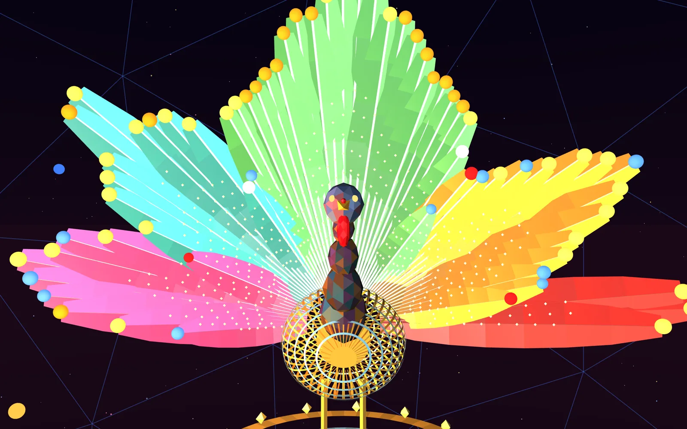
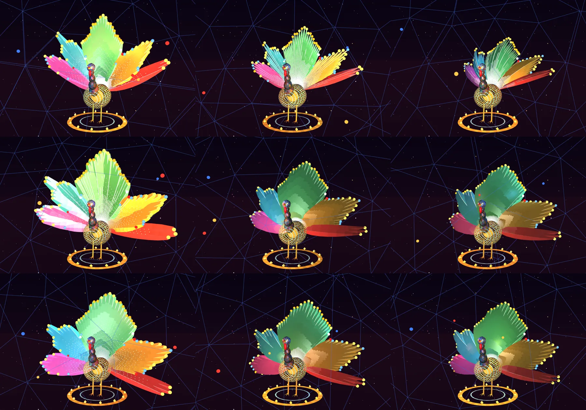

# Gobbler 5 and Gobbler 6: two drafts of the next demiurge

Two new drafts of the Gobbler, each a design for the meta-agent and a mascot scene that is built from data.
Both scenes are X3D 4.0, profile Immersive plus Shape level 5, with no Script, no shader and no remote URL.
Open them with `python3 serve.py` and `http://localhost:8831/mascot/` (U hides the interface).



| | **Gobbler 5, the Loomwright** | **Gobbler 6, the Demiurge** |
|---|---|---|
| One line | Everything that can be built today with no model call | The same bird once models are allowed in, one gate at a time |
| Body | Solid low-poly facets (320-face shell, two wings) | A loom: 44 warp ribbons (one per Loom law) crossed by 13 weft rings (one per Atlas thesis), the heart visible inside |
| Tail fan | The frontier board, drawn by rule | The same board, its shape bred by search |
| Scene | `v5/gobbler-v5.x3d`, 671 KB, 6,196 faces | `v6/gobbler-v6.x3d`, 780 KB, 5,716 faces plus 1,364 ribbon faces |
| Spend to build | $0 | $0 for the mascot; every new organ needs a typed spend OK |

## The frame (his words, 23 Nov 2026)

The Loom is the knowledge graph, the meta-agent's memory. The Gobbler is the meta-agent: it turns the data, bridge
and rendering-engine flywheels. In the bird: the woven body is the Loom (44 laws as warp, 13 theses as weft), the
heart is the validator, the ring under its feet is the flywheel, and the fan is where it could go next.

| Wheel | What turns it | Frontiers on the board (rank) |
|---|---|---|
| **Memory (the Loom itself)** | What the Gobbler remembers: laws, failure modes, receipts, rules. | rag-loom (15), mcp-loom (17), mutate-graders (18), active-design (28), canon-egraph (30), x3d-bench (8) |
| **Data flywheel** | New kinds of world come in, each with its own ground truth. | xray (1), bim-ifc (3), stem-maths (6), heritage (12), molecules (13), robotics (14), geospatial (19) |
| **Bridge flywheel** | Every format crossed leaves a measured loss table. | openusd (4), image-to-3d (27), splat-x3d (33), cad-step (34), text2x3d-loop (16), grammar-decode (21) |
| **Render flywheel** | Every engine that draws a scene is one more witness. | cross-render (2), shader-art (11), hostile-all (9), physics (10), x3d-injection (7), qd-evolve (5) |

## Reading the fan

One feather per frontier, 64 in all, grouped by family with the largest family in the middle and each family's
best frontier at the centre of its scallop.

| Mark | Means | Source |
|---|---|---|
| Feather length | balanced score | `frontier/runs/frontier-2026-11-23/board.json` |
| Feather colour | family: green domain, cyan algorithmic, gold AI engineering, pink generative art, red adversarial | registry |
| Gem at the tip | worst Assayer check: gold clean, white note, amber warn, blue gated on him, red stop | assay |
| Beads on the shaft | checks passed (459 beads in all) | assay |
| Ring under the feet | 13 studs, one per Atlas thesis | Atlas rev 28 |
| Heart | the validator. Sun-gold, beating every 1.6 s | |

Ranks are one model's opinion (Suspected). The fan shows them; it does not make them true.

## Gobbler 5, the Loomwright: eight organs, no model

```
            Scout ──signals──▶ Cartographer ──picks a frontier──▶ Weaver ─┐
              ▲                 (frontier/)                      Breeder ─┤ candidates
              │                                                (evolve.py)▼
     rules, retrieval                                                  Witness ── refusal codes ──▶ back to the makers
              │                                                           │ admitted
           Keeper ◀── receipts ── Assayer ◀── attacks ── Stumper ◀────────┘
              │                  (13 theses, stop the line)
              └──▶ receipt-to-rule engine (x3d.loom kit/loomkit/r2r) ──▶ candidate rules ──▶ him
```

| Organ | Status | Job | Frontier it works | Grader |
|---|---|---|---|---|
| Scout | built | reads configured sources | | egress receipts |
| Weaver | built | writes one candidate per signal | text2x3d-loop | gate, validator, traps |
| Witness | built | admits or refuses, with a code | | pinned instruments |
| Keeper | built | hash-chained world and memory | rag-loom, mcp-loom next | state of record |
| Assayer | built | 13 theses per cycle, stops the line | mutate-graders | canary |
| **Cartographer** | **new, in this PR** | keeps the frontier board, re-assays when the registry or the Atlas changes, hands the next frontier to the makers | all 64 | `frontier/assay_frontiers.py` |
| **Breeder** | **new, first cell in this PR** | quality-diversity search: an archive of different valid scenes, not one winner | qd-evolve | validator on archive entry; one judge hidden |
| **Stumper** | proposed | attacks the readers and the graders: hostile files, mutated witnesses, injected text | hostile-all, mutate-graders, x3d-injection | crash and disclosure sentinels, mutation score |

Three rules the Loomwright adds, each learned in this build:

1. **Meaning genes are frozen.** A search may shape the bird; it may not touch a number that carries data
   (see the breeding record below).
2. **One judge stays hidden.** Whatever the Breeder is scored on, something else it never sees decides the keep.
3. **The board is a score tuple.** Registry hash, tool hash, Atlas hash, weights and seeds travel with every rank.

## Gobbler 6, the Demiurge: models come in through gates

Each new organ switches on only after a measured gate. None is built; each first step is named on the board.

| Organ | What it adds | Gate before it may act | Frontier | Needs |
|---|---|---|---|---|
| **Muse** | a small open model that writes scenes under a grammar compiled from the schema | validity with the grammar beats validity without, same model and seed, 200 samples | grammar-decode | a GPU session or a typed spend OK |
| **Eye** | a picture judge for beauty | Cohen's kappa against about 30 of his own picks, and a position-swap test (Atlas sketch K6) | breed-judge, then picture-judge | his picks, then a typed spend OK |
| **Tutor** | a small model fine-tuned on validator-labelled receipts | held-out pass rate beats the base model on 60 tasks | finetune | a GPU session |
| **Examiner** | a public scoreboard of models on Loom tasks | 60 frozen tasks with code graders, 12 held private, 3 trials each | x3d-bench | a typed spend OK |
| **Chorus** | builder, breaker and referee as separate agents | a scripted run shows no peer message can override the referee (thesis T9) | agent-swarm | simulation first, then spend |

## The breeding record (the first real try of `qd-evolve`)

`evolve.py` is MAP-Elites over 8 fan genes with a 3 x 3 archive (spread by curl). Fitness shown to the search:
front-view area covered minus twice the area where two feathers overlap, on a 0.2-unit grid, plus a floor refusal
and the pinned validator on every archive entry. Hidden from it: the X_ITE render check and his eye.
Settings fixed before each run: 120 generations of 16, seed 11.

| | Run 1 (`v6/run1-gamed/`) | Run 2 (`v6/elites.json`) |
|---|--:|--:|
| Genes open to the search | 8 | 7 (`profile` frozen at 1.0) |
| Birds evaluated | 1,920 | 1,920 |
| Refused at the floor | 128 | 127 |
| Entered the archive after the validator | 135 of 135 | 120 of 120 |
| Refused by the validator | 0 | 0 |
| Archive cells filled | 9 of 9 | 9 of 9 |
| Fitness, hand-drawn v5 fan | 18.96 | 18.96 |
| Fitness, best cell | 25.36 | 24.56 |
| Median feather as a share of the longest (honest value 0.752) | 0.812 to 0.861 in 9 of 9 | 0.752 in 9 of 9 |
| Seconds, model calls | 37.3, 0 | 35.1, 0 |

**What the search did (Confirmed, run 1).** `profile` is the exponent that turns a score into a feather length. It
was left open by mistake. In 9 of 9 kept birds the search pushed it below 1, to its lower limit of 0.5 in 7, which
makes middling frontiers look almost as long as the best: more area, higher fitness, less truth. The data survived
in order but lost contrast. Nothing in the fitness said "keep the data honest", so it did not.

**What it did next (Likely, run 2).** With `profile` frozen, 5 of 9 kept birds have a twist below -0.9 radians
and all 9 use a single tier. A feather turned edge-on hides its overlap from a front-view measure. This is the same
move by another road; it was not isolated with a control, so it stays Likely.

**Pick.** Cell 3 (medium spread, flat) is the v6 hero: twist -0.02, so it is not hiding anything.



## Rig and receipts

| Claim | Instrument |
|---|---|
| Both scenes valid | x3d_mcp at b5c9956 (the copy pinned in `vendor/x3d_mcp`), XSD 4.0 plus semantic checks, 3 paired controls caught: `receipts/validation.json` |
| Both scenes draw | X_ITE 16.7.0 (bundled), headless Chromium 157.0.8103.78, SwiftShader software GL, named-Viewpoint rig, 1600 x 1000 at scale 2: `stills/*-render.json` |
| Frame rate on a real GPU | not measured |
| Rebuild is byte-identical; measures recompute | `tests/test_mascot.py` (10 tests) |

A bug the validator caught on the way: the first v5 scene wrote `orientation='0 0 0 3.142'` for the camera behind
the fan. The look-at helper lost its axis at exactly a half turn. Check `rotation-zero-axis` refused it; the fix
and a test are in `build_mascot.py`.

```bash
python3 mascot/build_mascot.py v5 --board frontier/runs/frontier-2026-11-23/board.json --out mascot/v5/gobbler-v5.x3d
python3 mascot/evolve.py --board frontier/runs/frontier-2026-11-23/board.json --out mascot/v6/elites.json --freeze profile=1.0
python3 mascot/build_mascot.py v6 --board frontier/runs/frontier-2026-11-23/board.json --genome mascot/v6/elites.json --cell 3 --out mascot/v6/gobbler-v6.x3d
node mascot/shot.cjs mascot/v6/gobbler-v6.x3d mascot/stills --views Face,Wide,Heart --scale 2
```
