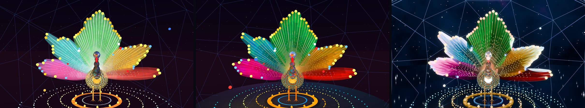

# Gobbler 6.2: the glass bird with its Cycles light baked into the X3D (24 Nov 2026)

His word on 23 Nov, 7:39 PM Eastern, to the question bake, spin, both or hold: "BOTH! and I cant wait to get it into
Unreal". This folder is the bake. The spin is in `../glass/spin/`. `../glass/` is untouched.



*Left: Gobbler 6.1 in the browser, lit live by X_ITE. Middle: this version in the same browser from the same seat,
light baked. Right: the Cycles frame the light came from. X_ITE 16.7.0 as vendored, unpatched, headless Chromium
157 on SwiftShader (`stills/xite-render.json`).*

## What "baked" means here

The Cycles frames in `../glass/` get their look from glass and metal, and what glass and metal show depends on
where the eye is. A bake stores one colour per face, so it cannot hold that. What it can hold is everything that
does not depend on the eye: which faces the coloured back lights reach through the fan, the pool of light the bird
throws on the floor, the heart lighting the ribbons around it, soft shadow. So:

1. `build_mascot.py baked` (no `--bake`) writes the pre-bake scene: the glass bird plus a new floor disc of 2,688 faces.
2. It goes into Blender through the x3d-blender-io importer, as before.
3. `blender/bake_light.py` gives each part a view-free stand-in (a matt surface in its own colour, a share of
   light let through from behind for the glass parts, a share of its own glow), puts the same lights and sky around
   it that the stills used (`render_glass.light_rig()`), and bakes in Cycles to the face corners.
4. The corners of each face are averaged, exposed, rolled off on luminance with the hue kept, and given the sRGB
   curve. The result is `bake.json`: one display colour for each of 11,616 faces in 11 named parts, with the settings.
5. `build_mascot.py baked --bake bake.json` writes the same geometry with those colours under `UnlitMaterial`, so
   the browser draws them as they are and does no lighting sum for those parts.

The spheres (heart, gems, eyes, light bulbs), the lattice and the stars are not baked; they glow as before.

## Numbers, each with its counter

| What | Value | Counter, grade |
|---|---|---|
| Parts baked / faces | 11 / 11,616 | `bake.json` `meshes`, C |
| Blender polygon order against X3D face order | worst mismatch 0.0 m on every part | `bake_light.py` compares every polygon centre before writing, C |
| Bake time | 17 s for all parts, 128 samples, seed 7, CPU | `bake.json`, C on this rig (4 cores) |
| Exposure | 85th-percentile vane face set to 0.65 linear, gain 3.69 | `bake.json` `exposure`, C |
| Colour channels outside 0 to 1 | 0 | test, C |
| Validator | pass | pinned x3d_mcp, `tools/validate_scene.py`, C |
| X_ITE load | no errors, three seats not black | `stills/xite-render.json`, C |
| File | 1.25 MB against 0.95 MB for 6.1 (the floor adds 2,688 faces) | `ls`, C |

No frame rate is quoted: the browser rig is software GL.

## Three rounds, and what each taught

1. **Everything gold came out lemon yellow.** The stand-ins glowed too much and each channel was clipped at 1 on
   its own, so every lit gold face was the same (1, 1, 0.4).
2. **Then everything gold came out white.** The fix rolled luminance off and pulled over-range colours toward
   grey. Faces next to the heart are many times over range, so they went all the way to grey-white.
3. **Kept.** Roll luminance off, and if a channel is still past 1, dim the face and keep its hue and saturation.
   Gold stays gold and keeps a gradient.

All three were judged by eye on browser frames (C by eye, one viewer: the model that made them). The validator
passed all three: valid is not the same as good-looking.

## Honest limits

- The fan sways, and the baked light on it does not move with it. The sway is small; the light is the light of
  frame 1 (L that nobody will notice, not tested with a person).
- One colour per face. Inside a large face there is no gradient. The faces are small facets, which is the look.
- The stand-ins are a choice. A different share of let-through light gives a different bird. They are written in
  `bake.json` so the choice can be argued with.
- It does not look like the Cycles frame, and cannot: no reflections, no refraction. It looks like the same bird
  under the same lights.

## Rebuild

```bash
B="--board frontier/runs/frontier-2026-11-23/board.json --genome mascot/v6/elites.json --cell 3 --counts mascot/glass/counts.json"
python3 mascot/build_mascot.py baked $B --out /tmp/prebake.x3d
python mascot/glass/blender/import_count.py --addon ../x3d-blender-io --scene /tmp/prebake.x3d --blend /tmp/prebake.blend --out /tmp/import.json
python mascot/baked/blender/bake_light.py --blend /tmp/prebake.blend --scene /tmp/prebake.x3d --out mascot/baked/bake.json
python3 mascot/build_mascot.py baked $B --bake mascot/baked/bake.json --out mascot/baked/gobbler-baked.x3d
python3 tools/validate_scene.py mascot/baked/gobbler-baked.x3d
node mascot/shot.cjs mascot/baked/gobbler-baked.x3d /tmp/stills --views Hero,Heart,Low --w 1600 --h 900
```

Cycles is seeded, but a rebake on another machine or Blender build may differ in the third decimal; the committed
scene rebuilds byte for byte from the committed `bake.json` (test).
