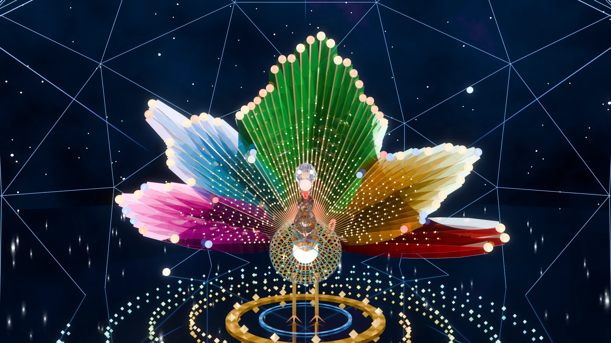
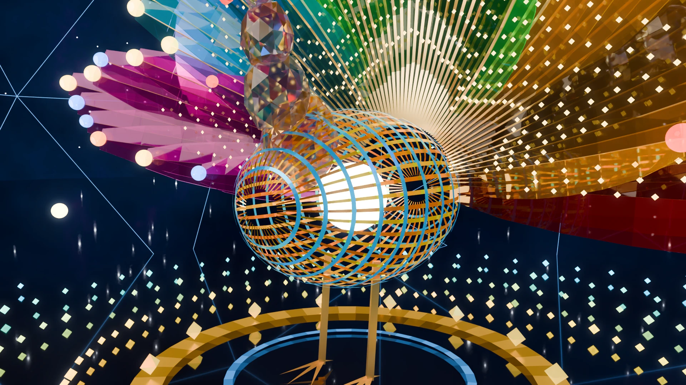
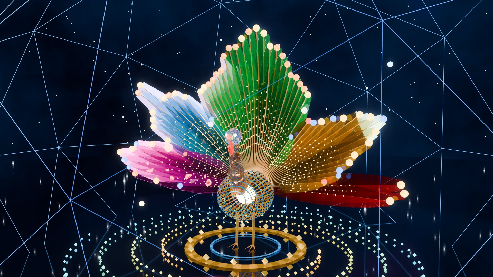
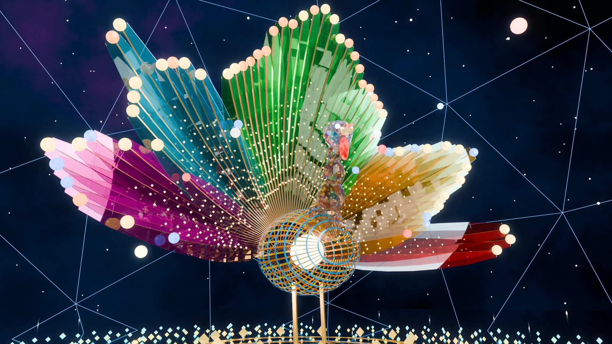

# Gobbler 6.1, the Glass Demiurge: the bird in Blender (24 Nov 2026)

His words, 23 Nov 2026: "lets go w gobbler, and most translucent best visuals from board ... of course the loom
will grow from 44 laws and 13+ theses, etc but this is a good viz. proceed. go for viz quality, blenderize!"

So this folder takes Gobbler 6 (the woven bird, bred fan, cell 3 of `../v6/elites.json`) and does three things.
Nothing in `../v5` or `../v6` was changed; their scenes still rebuild byte for byte (tests).

1. **The counts are read, not typed.** `../loom_counts.py` counts the law rows and the failure-mode rows in the
   Loom's own `LOOM-v1.md` and the theses in the pinned Atlas, and records the Loom commit beside them
   (`counts.json`). The body has one gold warp ribbon per law and one blue weft ring per thesis; a new three-arm
   spiral on the floor has one bead per failure mode, oldest gold in the middle, newest cyan at the rim.
   Today: **44 laws, 228 failure modes** (x3d.loom `139896f`), **13 theses** (Atlas rev 28). Re-run the counter
   after the Loom grows and the bird grows with it. A repeated number is refused; a gap is reported.
2. **The vanes are translucent in the X3D itself** (`transparency='0.45'`), and every shape has a DEF name
   (Vanes, Shafts, Beads, Loom, Body, Heart, FailureModes, WheelRing, one `Gem_<frontier>` per frontier), so a
   tool downstream can find the parts. Two more seats were added: `V_Hero` and `V_Low`.
3. **It goes through Blender**: in through the x3d-blender-io importer, lit and rendered in Cycles, out to glTF
   and USD, with a count at each door.

## Stills (Cycles on 4 CPU cores, 1920 by 1080, up to 160 samples, OpenImageDenoise: 270 s, 493 s, 276 s, 328 s)

| | |
|---|---|
|  |  |
|  |  |

The same scene in the browser, for the before picture: `stills/xite-hero.webp`
(X_ITE 16.7.0 vendored in this repo, unpatched, headless Chromium on SwiftShader; see its render receipt).

## What came through each door

Every number names its counter. Grades: C Confirmed (counted by the script named), L Likely, S Suspected.

**X3D into Blender** (`blender/import_count.py`, Blender 5.3.0 `bpy` wheel, add-on 2.7.4 at `0eb4809`;
`receipts/blender-import.json`). The scene first passed the pinned x3d_mcp validator (`tools/validate_scene.py`).

| In the X3D | In Blender | Grade |
|---|---|---|
| 84 Shapes | 83 meshes + 1 curve (the lattice) | C |
| 8,928 IndexedFaceSet faces | 8,928 polygons | C |
| 70 Spheres | 70 meshes of 256 faces | C |
| 7 Viewpoints, fieldOfView 0.72 | 7 cameras, 26.9 mm on 36 mm, which is 41.25 degrees tall at 16:9: the same angle | C |
| 4 lights | 4 point lights with their colours | C |
| 7 animated targets (TimeSensor + interpolator + ROUTE) | 7 actions | C |
| vanes `transparency` 0.45 | Principled alpha 0.55 | C |
| colour per face | corner colour attribute `ColorPerCorner` on all 10 face sets | C |
| 3 ROUTEs that move the three lights | **lost**, and the importer said so itself, by name | C |
| 81 Materials | 24 (equal ones merged; a merged material keeps one shape's name, so `Gem_bim_ifc` wears `Gem_splat_x3d`) | C |
| 3 PointSets (the stars) | 3 meshes with vertices and no faces: Cycles draws nothing for them | C |
| shared vertices | none: 3 vertices per triangle, 4 per quad (weld before a Solidify) | C |

**What the Blender pass added** (`blender/render_glass.py`; the full list is in every render receipt under
`added_in_blender`): glass and metal Principled materials driven by the imported colours, a weld and a 3 cm
Solidify on the vanes so the glass has two faces, a mirror floor, four area lights, a noise night sky, a bevel on
the lattice curve, spheres on the star points, depth of field, the AgX view. The glow is added afterwards by
`blender/finish_stills.py` and is declared as post in the receipt. No mesh, colour, camera or animation was made
by hand: those all came through the importer.

**Blender out to glTF and USD** (`blender/export_check.py`: export, read the file back into an empty Blender,
count; `receipts/blender-exports.json`).

| | In Blender | glTF 2.0 (.glb, 2.7 MB) | OpenUSD (.usdc, 1.8 MB) |
|---|---|---|---|
| meshes | 84 (+1 curve) | 82 (the 3 star point clouds are gone; the lattice curve became a mesh) | 87 (+2 curve objects) |
| polygons | 28,897 | 51,478 (triangulated) | 28,897 |
| lights | 8 | 4 (the four area lights are gone) | 8 |
| cameras | 7 | 7 | 7 |
| glass materials (transmission) | 10 | 10 | 10 |
| glowing materials | 23 | 22 | 21 |
| colour attribute on meshes | 10 | 10 | 10 |
| animation | 7 actions | 7 actions (as 7 NLA tracks) | 8 transform caches, 0 actions |

All C by the script's own read-back. Read-back is by Blender's own importers, so a loss could sit in the writer
or the reader; that split is not tested here (S either way).

## Rebuild

```bash
python3 mascot/loom_counts.py --loom ../x3d.loom --out mascot/glass/counts.json
python3 mascot/build_mascot.py glass --board frontier/runs/frontier-2026-11-23/board.json \
    --genome mascot/v6/elites.json --cell 3 --counts mascot/glass/counts.json --out mascot/glass/gobbler-glass.x3d
python3 tools/validate_scene.py mascot/glass/gobbler-glass.x3d
# Blender side: any Python with the bpy 5.3 wheel, and a checkout of x3d-blender-io
python mascot/glass/blender/import_count.py --addon ../x3d-blender-io --scene mascot/glass/gobbler-glass.x3d \
    --blend /tmp/gobbler-glass.blend --out mascot/glass/receipts/blender-import.json
python mascot/glass/blender/render_glass.py --blend /tmp/gobbler-glass.blend --out /tmp/final \
    --views V_Hero,V_Heart,V_Wide,V_Low --save /tmp/gobbler-glass-lit.blend
python3 mascot/glass/blender/finish_stills.py --raw /tmp/final --out mascot/glass/stills
python mascot/glass/blender/export_check.py --blend /tmp/gobbler-glass-lit.blend --outdir mascot/glass/exports \
    --receipt mascot/glass/receipts/blender-exports.json
```

Do not name a helper script `inspect.py` beside these: it shadows Python's own `inspect`, and `import bpy` then
dies with "You called InitGoogleLogging() twice" and no mention of the real cause (seen once here, C; cause L).

## Not done

- The Blender look is not written back into the X3D. The browser bird keeps its own lights; baking the Cycles
  light into vertex colours for the browser is the next step if he wants the web version to look like this.
- No frame rate is quoted anywhere: the browser still is from software GL.
- The three light-orbit ROUTEs are lost at import, so the Blender frame has still coloured lights.
