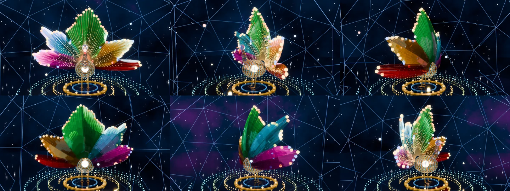

# The glass Gobbler, one turn in Cycles (24 Nov 2026)

His word: "BOTH!" (bake and spin). The bake is `../../baked/`. This is the spin.

`gobbler-glass-spin.mp4`: 120 frames, 960 by 540, 24 frames a second, 5 seconds, 5.6 MB. One camera walks a
circle of radius 22.5 m at 7.6 m height round the bird, starting in front. The bird's own X3D animation runs
underneath: the scene clock covers 216 frames in the turn, so the fan's sway closes the loop.



| What | Value | Source, grade |
|---|---|---|
| Render | Cycles, CPU (4 cloud cores), up to 64 samples, adaptive 0.03, OpenImageDenoise, seed 7 | `blender-spin.json`, C |
| Time | 4,269 s for 120 frames, mean 35.6 s, 25.6 to 43.1 s | the render log, summed into `blender-spin.json`, C |
| Scene | `../gobbler-glass.x3d` through x3d-blender-io 2.7.4 (`0eb4809`), Blender 5.3.0 | same import as the stills, C |
| Added in Blender | everything the stills added, plus the orbit camera | `added_in_blender`, C |
| Post | per-frame glow (as `finish_stills.py`), H.264 yuv420p crf 18 | `blender-spin.json`, C |

The cloud machine restarted after frame 26. The 27 finished frames were kept, checked readable, and the render
resumed at frame 27 with the same script and seed. The receipt says so.

Not perfect: the heart's beat does not close on the loop (its period does not divide the turn), so there is a small
jump in the heart at the seam. From the back the two rear lights shine straight through the fan, which is why the
back view is brighter.

```bash
python mascot/glass/blender/spin_glass.py --blend /tmp/gobbler-glass.blend --out /tmp/spin --frames 120
```
